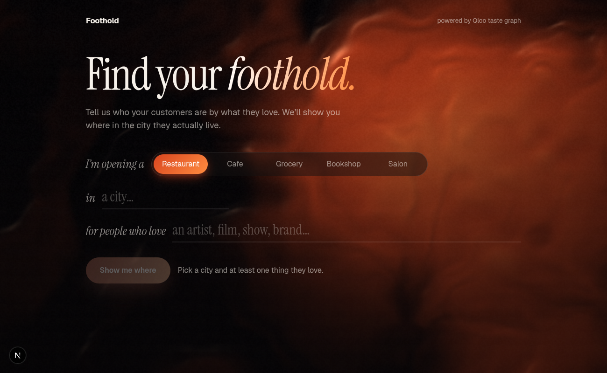
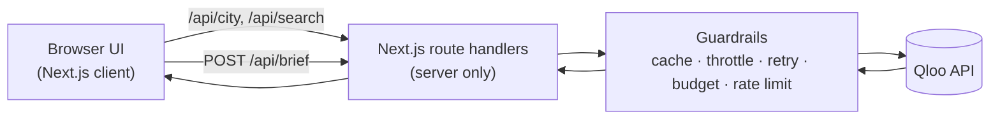

# Foothold — Where To Open Your Business In A New City

> Tell us who your customers are by what they love. Foothold shows you where in the city they actually live, using the [Qloo](https://qloo.com) taste graph.

[](LICENSE)
[](https://nextjs.org)
[](https://qloo.com)

**Built for the [Qloo Agentic Hackathon](https://qloo.devpost.com). Free and open source.**



---

## Live

- 🌐 **Live demo:** https://foothold-five.vercel.app
- 💻 **Repo:** https://github.com/shegz101/foothold

---

## Table of Contents

- [Quick Path](#quick-path)
- [The problem](#the-problem)
- [Why it stands out](#why-it-stands-out)
- [What it does](#what-it-does)
- [Architecture](#architecture)
- [How Qloo is used](#how-qloo-is-used)
- [Reliability and guardrails](#reliability-and-guardrails)
- [Requirements](#requirements)
- [Run locally](#run-locally)
- [Usage and test sets](#usage-and-test-sets)
- [Deployment](#deployment)
- [Project layout](#project-layout)
- [Known limits and roadmap](#known-limits-and-roadmap)
- [Contributing](#contributing)
- [License](#license)

---

## Quick Path

```bash
git clone https://github.com/shegz101/foothold.git
cd foothold
npm install
cp .env.example .env      # add your Qloo hackathon API key
npm run dev               # http://localhost:3000
```

Then try: **restaurant** in **Houston, Harris, Texas**, for people who love **BTS** (artist) and **Squid Game** (tv show).

---

## The problem

An immigrant or first-time owner entering a new city usually knows their customers' *taste* (for example, fans of Afrobeats and Nollywood) but not which neighborhoods hold those people, who the nearby competitors are, or which brands and artists reach them. Generic advice like "open near foot traffic" doesn't help.

## Why it stands out

- **Qloo drives the core output, it doesn't decorate it.** Every neighborhood, venue, demographic and partner in the brief is a field Qloo returned. Without Qloo there is nothing to show.
- **Taste to place.** Anchors (artists, films, shows, books, games, brands) are turned into a *geographic* answer through Qloo's heatmap, not just a list of recommendations.
- **Explainable venues.** Each venue shows which of your anchors drove the match (Qloo explainability).
- **Honest about gaps.** Missing fields (like price level) are shown as missing. Thin cities get a plain-language note instead of padded results.
- **Wrong-city protection.** Cities are resolved to a disambiguated Qloo locality that you confirm, so a typo can't silently land you on another continent.

## What it does

1. **Pick a business type:** restaurant, cafe, grocery, bookshop or salon.
2. **Confirm a city:** free-text search returns Qloo localities such as "Houston, Harris, Texas".
3. **Add 1–5 anchors:** artists, movies, TV shows, books, podcasts, video games, brands or people, each resolved to a real Qloo entity you confirm.
4. **Get a Market Entry Brief:**
   - **Customer profile:** age and gender affinity (Qloo demographics, averaged across anchors).
   - **Where they are:** a map of the hottest heatmap cells plus ranked neighborhoods.
   - **Venues they already love:** audience-matched places, with a per-anchor contribution bar. Chains are collapsed into one card.
   - **Partners and marketing:** high-affinity brands, plus artists and podcasts for in-shop music and advertising.
   - **Shop vibe:** ambience tags the audience prefers.

## Architecture



The Qloo API key lives only on the server. The browser talks to our own `/api/*` routes, never to Qloo.

## How Qloo is used

| Capability | Qloo endpoint | Used for |
|---|---|---|
| Entity resolution | `/search` | Turn anchor names into Qloo entity IDs |
| Locality resolution | `/search` (`urn:entity:locality`) | Disambiguated, user-confirmed city |
| Demographics | `/v2/insights` (`urn:demographics`) | Age and gender affinity of the audience |
| Heatmap | `/v2/insights` (`urn:heatmap`) | Where the audience concentrates; neighborhood ranking |
| Places + explainability | `/v2/insights` (`urn:entity:place`, `feature.explainability`) | Existing venues and which anchors drove each match |
| Partners and channels | `/v2/insights` (`brand`, `artist`, `podcast`) | Partner brands, in-shop music, advertising |
| Ambience | `/v2/insights` (`urn:tag`, ambience tags) | Shop vibe |
| Tags | `/v2/tags` | Place category filters per business type |

**Neighborhood ranking:** Qloo's heatmap returns coordinates, not names. We take the hottest 60 cells, name each by the nearest Qloo place's neighborhood (within 2.5 km), and rank neighborhoods by hot-cell count and mean affinity.

## Reliability and guardrails

- **Cache:** 24-hour response cache with in-flight request de-duplication.
- **Rate limiting to Qloo:** about 4 requests per second, with exponential backoff on `429`. A `429` is never treated as "no results".
- **Budget guard:** monthly call counter (default 8,000 of Qloo's 10,000), configurable.
- **Per-visitor limit:** a cap on briefs per hour per visitor.
- **Key safety:** the API key is server-only. `.env` is gitignored.
- **Note:** cache, limiter and budget are in-memory, so on serverless hosts they are per warm instance (see [roadmap](#known-limits-and-roadmap)).

## Requirements

- Node.js 20 or newer (developed on Node 24)
- A Qloo hackathon API key. Hackathon keys only work against `https://hackathon.api.qloo.com`.

## Run locally

1. **Install**

   ```bash
   npm install
   ```

2. **Configure environment**

   ```bash
   cp .env.example .env
   ```

   | Variable | What to put |
   |---|---|
   | `QLOO_API_KEY` | Your Qloo hackathon key (required, never commit it) |
   | `QLOO_BASE_URL` | `https://hackathon.api.qloo.com` (default) |
   | `QLOO_MONTHLY_BUDGET` | Max Qloo calls per month before the app stops calling (default 8000) |
   | `BRIEF_LIMIT_PER_HOUR` | Briefs per visitor per hour in production (default 10) |

3. **Start**

   ```bash
   npm run dev      # development
   npm run build && npm start   # production
   ```

**Probe script:** `npm run probe -- Chicago London` calls each Qloo endpoint and reports what works. Raw outputs are written to `probe/out/` (gitignored, never commit them).

## Usage and test sets

Pick the **artist**, **tv show** or **movie** entry in the dropdown (names can have several matches), and the city option with the right region.

| Business | City | Anchors |
|---|---|---|
| restaurant | Chicago (Cook County, Illinois) | Burna Boy (artist), Wizkid (artist), Living in Bondage (movie) |
| cafe | Houston, Harris, Texas | BTS (artist), Squid Game (tv show) |
| salon | Atlanta, Fulton, Georgia | Beyoncé (artist), Cardi B (artist), Love & Hip Hop (tv show) |
| bookshop | London, Greater London, England | Stormzy (artist), Michaela Coel (person), Chimamanda Ngozi Adichie (person) |
| grocery | Los Angeles, California | Bad Bunny (artist), Narcos (tv show), Coco (movie) |

## Deployment

Deploy to [Vercel](https://vercel.com): import the repo, set the environment variables above, and deploy. Set `QLOO_API_KEY` as a server-side (non-public) variable.

## Project layout

```
src/
  app/
    page.tsx              # client-only entry
    layout.tsx            # fonts, metadata
    globals.css           # design system and motion
    api/
      city/route.ts       # locality search
      search/route.ts     # anchor entity search
      brief/route.ts      # builds the Market Entry Brief
  components/
    Home.tsx              # form: business, city, anchors
    Brief.tsx             # the brief
    HeatMap.tsx           # audience map from real heatmap cells
    GradientField.tsx     # WebGL gradient background
    ui.tsx                # micro-interaction components
  lib/
    qloo.ts               # Qloo client: cache, throttle, retry, budget
    foothold.ts           # brief-building logic
    ratelimit.ts          # per-visitor limiter
probe/probe.mjs           # endpoint probe script
```

## Known limits and roadmap

- **Qloo data limits:** price level is often missing, and Qloo provides no rent data, so Foothold doesn't promise either. Place results can include off-target venues such as banquet halls.
- **No LLM agent layer yet.** The brief is built by deterministic code from Qloo responses. A Claude tool-use layer and a "Without Qloo vs With Qloo" comparison are planned.
- **"Before you open" checklist** (licences, permits, fees with official links, labeled as non-Qloo) is planned for demo cities.
- **Shared state:** move the cache, rate limiter and budget counter to Redis so they hold across serverless instances.
- **Tests:** unit tests for ranking logic and an end-to-end smoke test.

Results describe what groups tend to like, not what one person will do.

## Contributing

1. Fork the repo and create a branch.
2. Keep your Qloo key in `.env` and never commit it or raw Qloo response data.
3. Run `npx tsc --noEmit` and `npm run lint` before opening a pull request.

Good first areas: venue quality filters, more business types, permit checklists for new cities.

## License

[MIT](LICENSE) © 2026 Bobate Olusegun
